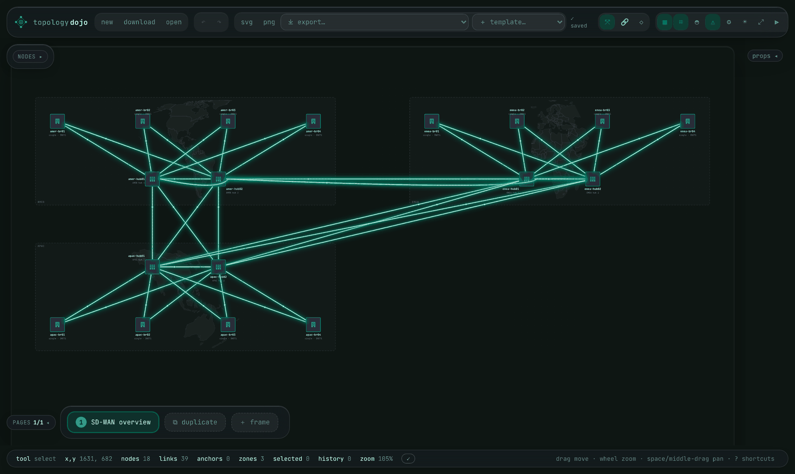

# Topology Dojo

Network topology diagrams that a person can draw and an AI agent can generate,
in the same format, with the same renderer.



There are two ways to author a diagram, and they produce the same document:

- **The editor** — a browser canvas for drawing by hand.
- **The MCP server** — tools an agent (Claude, or any
  [Model Context Protocol](https://modelcontextprotocol.io) client) calls to
  build, validate, lay out, render and export a diagram.

Everything a person can set in the editor's inspector, an agent can set through
the API, so a diagram looks the same whoever made it. The exceptions are
deliberate: view state (pan, zoom, theme) and owner-only actions stay in the
browser.

## Use it

**Hosted editor:** <https://topology-dojo.harnessed.cloud> — sign in with
GitHub.

**Hosted MCP server:** add `https://topology-dojo.harnessed.cloud/mcp` to your
MCP client as a remote (Streamable HTTP) server. Sign-in is GitHub OAuth in the
browser; there is no key to paste. In Claude Code:

```bash
claude mcp add --transport http topology-dojo https://topology-dojo.harnessed.cloud/mcp
```

Then ask for a diagram ("draw a dual-hub SD-WAN fabric with four branches and
show it"). In chat hosts that support MCP Apps, `view_topology` renders the
result inline with pan, zoom, layers and downloads.

The server is described for MCP directories in [`server.json`](server.json).
Tool reference, local stdio setup and auth details:
[`src/mcp/README.md`](src/mcp/README.md).

## Run it locally

Needs Node.js 22 (the version CI uses).

```bash
npm ci
npm run dev    # editor at http://localhost:5173
npm run mcp    # MCP server over stdio, no account needed
```

The local editor has no backend: documents autosave to browser storage, and
sign-in, sharing and the shared workspace need the hosted Worker. The local
MCP server keeps topologies in memory for the life of the process.

| Command             | What it checks                                         |
| ------------------- | ------------------------------------------------------ |
| `npm test`          | Unit tests (Vitest)                                    |
| `npm run lint`      | ESLint and Prettier                                    |
| `npm run typecheck` | The app and the Cloudflare Worker                      |
| `npm run build`     | App typecheck and production bundle                    |
| `npm run test:e2e`  | Chromium release gate; visual baselines are Linux-only |

## What it does

**Draws network diagrams, not generic boxes.** The node palette is network
gear (SD-WAN edges, switches, routers, firewalls, clouds), links have types
(tunnel, optical, wireless, PoE and more), and zones, flow paths and policy
markers sit on an annotation layer. You can define your own node types in the
Node Designer.

**Generates an SD-WAN fabric from a few choices.** The SD-WAN wizard
(`template…` menu, or the `generate_sdwan_topology` tool) takes vendor, regions,
hubs, branches, WAN links and HA, and builds the fabric with tunnel counts that
follow the vendor's behaviour. HPE EdgeConnect and Juniper SRX are supported
today. Design and limits:
[proposal 0010](docs/proposals/0010-sdwan-generator.md).

**Produces wiring sheets.** Nodes can bind to real hardware models from the
[hardware catalog](catalog/README.md), so a cable has to land on an interface
that exists, with a compatible optic and speed. Wire-sheet pages draw front
panels with cables at the real port positions, plus link styles, tiers, LAG
bundles, port tables and a title block. The catalog is small so far (a handful
of models built from fixtures, not vendor data feeds); status is in
[`docs/futures/hw-catalog.md`](docs/futures/hw-catalog.md).

**Exports to what network teams already use.** PNG and PDF (print-true on ANSI
and A-series sheets), draw.io, Visio `.vsdx`, PowerPoint `.pptx`, Mermaid, SVG,
and a self-playing HTML flipbook. draw.io and Mermaid diagrams import. What
each format keeps and drops: [`docs/EXPORTS.md`](docs/EXPORTS.md). The Visio
and PowerPoint output has been checked in LibreOffice, not yet in the Microsoft
apps.

**Tells a story across pages.** A document is an ordered list of pages, each
one a complete diagram. Duplicate a page, change it, and flipping between them
is the animation ("before and after", "failover", "packet walk").

**Keeps agent output tidy.** Generated diagrams tend to overlap. The API
publishes its layout rules, `validate_topology` reports overlaps,
`inspect_render` checks the drawn result for collisions and clipped labels, and
`tidy_topology` fixes spacing. The loop an agent follows is discover, build, validate,
tidy, render.

**Lets a person and an agent work on one diagram.** In the hosted editor's
Agent Workspace, an agent proposes changes that you review and accept in whole
or in part. It can write directly only under a page-scoped lease you grant from
the browser, which lasts ten minutes and can be revoked. Checkpoints, a
revision timeline, presence and offline recovery are included.

Task-by-task instructions for all of this are in the
**[User Guide](docs/USER_GUIDE.md)**.

### Behind a flag

These exist in the code but are switched off in production in
[`wrangler.jsonc`](wrangler.jsonc) at the time of writing:

- **API keys** for agents that cannot do a browser sign-in
  (`API_KEYS_ENABLED`; on in staging).
  [Proposal 0005](docs/proposals/0005-api-key-auth.md).
- **Live SD-WAN data** from an EdgeConnect Orchestrator (`LIVE_DATA_ENABLED`).
  The client is tested against fixtures only and has not been verified against
  a live Orchestrator.

## How it is built

```
src/
  pages/       the document model (pages, nodes, links, zones) and persistence
  api/         headless authoring: build, validate, lay out, tidy; no DOM
  render/      render core shared by Node and the Worker, plus inspect_render
  export/      PNG, PDF, draw.io, Visio, PowerPoint, Mermaid, cable schedules
  import/      draw.io, Mermaid and legacy-document importers
  catalog/     hardware catalog loader and interface resolution
  connect/     SD-WAN generator, and the live-data provider and flow compiler
  editor/ ui/  the canvas editor and its panels
  nodes/       custom node types and the Node Designer
  mcp/         MCP tools, store and registration (shared by stdio and Worker)
  workspace/   shared-workspace operations, conflicts and browser client
  profile/     learned authoring preferences
  share/       public snapshot links
  server/      Node-side headless renderer and helpers
  vendor/      typed facade over the vendored rendering engine
  core/        the retired beat model, kept for reference only
worker/        Cloudflare Worker: serves the app, /mcp, and per-document state
catalog/       hardware catalog data, schema and Python reference tools
public/vendor/ the vendored rendering engine and theme
e2e/           Playwright browser tests
```

The editor is one client of `src/api`; the MCP server is another. Hosted, the
app runs on Cloudflare Workers with Durable Objects for MCP sessions, the
per-user registry and each shared document, behind OAuth 2.1 with GitHub as
the identity provider.

## Deployment

Merging to `main` is the release. Every push that touches more than docs runs
CI, rehearses the build on staging, then deploys to production and smoke-tests
it, with no second approval. A release that adds a Durable Object migration is
held until a person dispatches the workflow and types the new migration tag.
The workflow is [`release.yml`](.github/workflows/release.yml); procedures are
in the [deployment runbook](docs/DEPLOYMENT_RUNBOOK.md) and the
[rollback runbook](docs/ROLLBACK.md).

## Documentation

| If you want to                            | Read                                                                                                                                                                                             |
| ----------------------------------------- | ------------------------------------------------------------------------------------------------------------------------------------------------------------------------------------------------ |
| Use the editor or connect an agent        | [User Guide](docs/USER_GUIDE.md), [MCP server](src/mcp/README.md), [exports](docs/EXPORTS.md)                                                                                                    |
| Pick up development                       | [Handoff](docs/HANDOFF.md) first, then [architecture](docs/ARCHITECTURE.md) and [design principles](docs/DESIGN.md)                                                                              |
| See what is built and what is next        | [Roadmap](docs/ROADMAP.md), [capability matrix](docs/CAPABILITY_MATRIX.md)                                                                                                                       |
| Understand why something is the way it is | [Decisions](docs/decisions/) and [proposals](docs/proposals/)                                                                                                                                    |
| Operate production                        | [Deployment](docs/DEPLOYMENT_RUNBOOK.md), [rollback](docs/ROLLBACK.md), [alerts](docs/ALERTS.md), [Cloudflare operator steps](docs/CLOUDFLARE_OPERATOR_RUNBOOK.md), [game day](docs/GAME_DAY.md) |
| Test a release                            | [QA plan](docs/launch-readiness/QA_TEST_PLAN.md), [UAT plan](docs/launch-readiness/UAT_PLAN.md), [traceability matrix](docs/launch-readiness/TRACEABILITY_MATRIX.md)                             |
| Build features with coding agents         | [Agentic implementation workflow](docs/AGENTIC_IMPLEMENTATION_WORKFLOW.md)                                                                                                                       |

`docs/archive/` and `docs/sitrep/` are dated records, not current status.

## License

Apache License 2.0; see [`LICENSE`](LICENSE). This covers the whole repository,
including the vendored rendering engine under `public/vendor/`, which is the
maintainer's own work.
