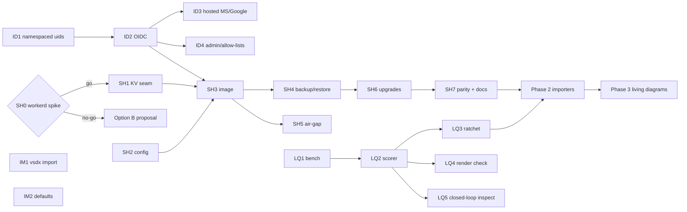

# Proposal 0009 — The network diagramming tool: any engineer, any vendor, hosted or self-hosted

**Status:** Proposed. Nothing here is scheduled until the owner accepts it;
on acceptance, `ROADMAP.md` _Now/Next_ and `IMPLEMENTATION_PLAN.md` are
re-cut from the packets below (see "Roadmap changes on acceptance").

**Captured:** 2026-11-03

**Decisions this proposal records** (Corey Robertson, 2026-11-03):

1. **Audience: any network engineer.** The product is vendor-neutral. It is
   not an HPE/Aruba/Juniper tool that happens to draw other vendors.
2. **Self-hosting is a supported deployment**, alongside the hosted
   Cloudflare service.

**Addresses:** the product goal _"when a network engineer thinks about
creating a beautiful network diagram, they do not go anywhere else."_

## Thesis

Topology Dojo does not win by out-drawing draw.io, Visio or Lucidchart. They
are free, entrenched or both, and feature parity only reaches "as good as."
It wins on what a generic canvas structurally cannot do: **a Dojo diagram is
a network model.** Nodes are devices with ports, roles, tiers and a source of
truth, so the tool can

- **generate** the diagram from the network instead of having it drawn,
- **lay it out well by default**, because it knows what a spine, an HA pair
  or a WAN edge is,
- **keep it true** as the network changes, and
- let an agent author it through the same contract a human uses.

Every packet below either removes a reason to leave or deepens that moat.
Work that does neither, such as general whiteboarding, is out of scope.

## Where we are (evidence, 2026-11-03)

| Area                      | State                                                                                                                                                          | Evidence                                                          |
| ------------------------- | -------------------------------------------------------------------------------------------------------------------------------------------------------------- | ----------------------------------------------------------------- |
| Authoring + agent surface | Strong: full editor, 62 MCP registrations, proposals/leases, per-owner learned preferences                                                                     | `ROADMAP.md` baseline, proposals 0002/0003                        |
| Exports                   | Strong: SVG, PNG, PDF, flipbook HTML, draw.io, Visio (per-model masters, glued wire sheets), PowerPoint, Mermaid, cable schedule                               | `src/export/`, `docs/EXPORTS.md`                                  |
| Imports                   | **Weak:** draw.io, Mermaid, CSV and legacy only. **No `.vsdx` import.**                                                                                        | `src/import/`                                                     |
| Live sources              | **Weak:** EdgeConnect Orchestrator only, never run against a real or recorded payload; Mist decided, not started                                               | `src/connect/`, decision 0002                                     |
| Identity                  | **Blocker:** GitHub OAuth only. `uid` is the bare GitHub numeric id and Durable Object names derive from it                                                    | `worker/auth.ts:182`, `worker/workspaces.ts:478`                  |
| Collaboration             | Single owner per workspace; org ACLs deferred                                                                                                                  | `ROADMAP.md` _Next_                                               |
| Vocabulary                | 37 node glyphs, 27 stock icons, 5 hardware models (Aruba, EdgeConnect, Juniper)                                                                                | `icons/`, `catalog/data/models/`                                  |
| Beautiful by default      | Partial: anchor box is EXPERIMENTAL/off, `clean` render profile is not the default                                                                             | `ROADMAP.md` _Next_                                               |
| Layout quality            | **Unmeasured.** `inspect_render` reports findings, but there is no benchmark set, scalar score or regression gate                                              | `src/render/inspect.ts`; no bench under `scripts/` or `fixtures/` |
| Deployment                | Cloudflare only: 5 SQLite-backed DO classes, 2 KV namespaces, static assets, hibernatable WebSockets (`worker/document.ts:298`); hosted on the owner's account | `wrangler.jsonc`                                                  |

Self-hosting starts from a good position. The Worker has **no R2, D1, Queues,
Browser Rendering or cron dependency**: rasterization is resvg WebAssembly, and
the only runtime outbound hosts are GitHub OAuth plus configured fabric
providers. The Worker and its Durable Objects already boot under Miniflare
(which runs on `workerd`) in 26 test files via `src/testing/worker-harness.ts`.
That is evidence the code runs on the open-source runtime. It is **not**
evidence that `workerd` alone, without Miniflare's KV emulation, is a
production host. Packet SH0 has to prove that.

## Goals

- A network engineer with no GitHub account can sign in, import what they
  already have (Visio, NetBox, LLDP output, a lab topology file) and get a
  diagram they would present, in under five minutes.
- A security-conscious organization can run the whole product inside its own
  network, with no phone-home and with its own identity provider, in under
  15 minutes from a documented image.
- Default output is good enough that most diagrams need no manual layout,
  measured by a scorer that CI enforces.
- The device and icon vocabulary covers a typical multi-vendor enterprise
  network without falling back to generic shapes.

## Non-goals

- General-purpose whiteboarding: flowcharts, org charts, freeform sketching.
- Multi-node / HA self-hosting in v1. A single-node deployment backed by a
  volume is the supported shape; scale-out is evidence-triggered.
- A Kubernetes operator or Helm chart in v1 (a compose file and image only).
- Any change to the architectural exclusions in `ROADMAP.md`: no second
  mutation path, no raw prompt logging, no silent agent writes, no
  cross-page inheritance.
- Bundling vendor icon sets whose license we have not verified.

## Vendor neutrality: what decision 1 binds us to

- **Starter templates, examples and showcase** cover at least three vendor
  ecosystems; none defaults to a single vendor's product names.
- **Generic roles come first.** Every node type has a vendor-neutral glyph
  (router, L3 switch, firewall, SD-WAN edge, WLC/AP, load balancer, NAC,
  cloud gateway). Vendor models are an optional binding through the hardware
  catalog, never required.
- **Agent guidance packs** (`src/profile/guidance-packs.ts`) do not steer
  toward a vendor's product unless the topology already names it.
- **Importers ship in a neutral-first order** (NetBox, LLDP, lab formats)
  before additional vendor controllers.
- **Ownership and licensing.** The repository is Apache-2.0 (proposal 0005).
  Confirm with the owner's employer that it raises no conflict with
  publishing a vendor-neutral product. This proposal cannot assess that; it
  is listed as an open question, not a packet.

## Workstreams and packets

Packets follow `AGENTIC_IMPLEMENTATION_WORKFLOW.md`. Each one is a bounded
PR with tests and evidence. Packet IDs are new and do not collide with
existing A/B/E/T/W/O series: `ID-` identity, `SH-` self-host, `IM-` import,
`LQ-` layout quality, `VO-` vocabulary, `LV-` living diagrams.

### Phase 1 — Remove the reasons people leave

#### Identity (prerequisite for both hosted reach and self-host)

| Packet | Scope                                                                                                                                                                                                                                                                                                                                                                                                                                                          | Risk                            |
| ------ | -------------------------------------------------------------------------------------------------------------------------------------------------------------------------------------------------------------------------------------------------------------------------------------------------------------------------------------------------------------------------------------------------------------------------------------------------------------- | ------------------------------- |
| ID1    | **Namespaced principals.** Introduce `provider:subject` uids for every new identity provider, e.g. `oidc:<issuer-hash>:`. **Existing GitHub uids stay bare numeric strings forever**, because every DO name (`document:<uid>:<id>`, registry, profile, `user-id:<uid>`) derives from them and renaming would orphan stored data. A GitHub numeric id can never contain `:`, so the namespaces cannot collide. Includes a test that asserts the invariant. | Medium: touches every auth path |
| ID2    | **Generic OIDC login** (authorization code + PKCE) for browser sessions and the `/mcp` OAuth flow (`workers-oauth-provider` upstream). Configured by issuer URL, client id and secret; discovery through `.well-known/openid-configuration`. Covers Entra ID, Okta, Google Workspace, Keycloak and Authentik with no per-vendor code.                                                                                                                          | Medium                          |
| ID3    | **Hosted presets:** "Sign in with Microsoft" and "Sign in with Google" next to GitHub on the hosted deployment, built on ID2.                                                                                                                                                                                                                                                                                                                                  | Low                             |
| ID4    | **Admin and allow-lists by uid list.** Replace `ADMIN_GITHUB_ID` with `ADMIN_UIDS` (keeping the old variable as an alias) and add an optional `ALLOWED_EMAIL_DOMAINS` / group-claim gate for self-hosted instances.                                                                                                                                                                                                                                            | Low                             |
| ID5    | **Account linking**: explicitly out of v1. One person who signs in with two providers gets two owners. Merging requires a verified-ownership flow; it is evidence-triggered.                                                                                                                                                                                                                                                                                   | (deferred)                      |

#### Self-hosting

| Packet | Scope                                                                                                                                                                                                                                                                                                                                                                                                                                                                                                                                                          | Risk                               |
| ------ | -------------------------------------------------------------------------------------------------------------------------------------------------------------------------------------------------------------------------------------------------------------------------------------------------------------------------------------------------------------------------------------------------------------------------------------------------------------------------------------------------------------------------------------------------------------- | ---------------------------------- |
| SH0    | **Viability spike (go/no-go).** Run the production bundle on `workerd` with a hand-written config and on-disk DO storage, **without Miniflare**. Prove: SQLite-backed DOs persist across restarts; hibernatable WebSockets (presence, `worker/document.ts`) work; static assets serve with SPA fallback; resvg WASM loads; `ctx.waitUntil` paths complete. Record which Cloudflare APIs are absent (KV at minimum). Output: a written verdict plus the config, with no product code. If `workerd` is not viable, fall back to **option B** below and re-scope. | **High**: everything depends on it |
| SH1    | **Platform seam for KV.** `TOPOLOGY_KV` (share snapshots and index) and `OAUTH_KV` (OAuth grants and tokens, API keys, failure counters) use `get`/`put` with `expirationTtl`/`delete`/`list`. Add a `KvLike` interface with two implementations: Cloudflare KV (hosted, unchanged) and a single SQLite-backed `KvStore` Durable Object (self-host) that honors TTL on read and sweeps lazily. Verify it covers everything `workers-oauth-provider` calls.                                                                                                     | Medium                             |
| SH2    | **Config, not constants.** Every deployment-specific value (`PUBLIC_BASE_URL`, IdP settings, flags, admin uids) comes from env or a mounted file, validated at boot. A missing or invalid value fails startup with an error that names the variable. No hosted ids leak into the self-host defaults.                                                                                                                                                                                                                                                           | Low                                |
| SH3    | **Image and compose.** OCI image with pinned `workerd` and base digests (no `:latest`), running as a non-root user with a read-only root filesystem, a single writable data volume, no added capabilities and a healthcheck. `docker-compose.yml` adds a TLS-terminating reverse proxy example. CI builds the image, scans it and runs the smoke suite (`scripts/smoke.mjs`) against it.                                                                                                                                                                       | Medium                             |
| SH4    | **Backup and restore through the product.** No file-copy of live SQLite. Use an authenticated admin export: every owner's workspaces, checkpoints, preferences and shares as a versioned archive. A matching import is idempotent. Restore is tested in CI (export → wipe → import → byte-identical renders).                                                                                                                                                                                                                                                  | Medium                             |
| SH5    | **Air-gap mode.** With `OUTBOUND=deny`, the Worker makes no requests except to the configured IdP and explicitly configured fabric providers. A test asserts that every `fetch` call site is on that allow-list. Analytics stay local; there is **no telemetry phone-home in any self-host mode**.                                                                                                                                                                                                                                                             | Low                                |
| SH6    | **Upgrades and migrations.** `workerd` has no Cloudflare-style DO migration tags. Document and test how a new DO class or SQLite schema change applies on self-host, keeping the append-only, inert-then-activate discipline. A boot-time guard refuses to start an image older than the data volume's schema.                                                                                                                                                                                                                                                 | **High**                           |
| SH7    | **Parity gate.** The worker-level test suite runs against both the Cloudflare/Miniflare target and the self-host image. A capability that cannot work on self-host is flagged in `CAPABILITY_MATRIX.md`, not silently missing. Self-host install guide in `docs/SELF_HOSTING.md`.                                                                                                                                                                                                                                                                              | Medium                             |

**Option B (only if SH0 fails):** a Node host that implements the DO and
KV contract the Worker uses, on SQLite (e.g. `better-sqlite3`) and `ws`. It
is more code to own, and it risks the divergence `ROADMAP.md` rules out, so
it would need its own proposal. It is not the plan.

**Self-hosting also unlocks live data.** A hosted Worker cannot reach a
customer's private NetBox or management network, and should not hold their
device credentials. A self-hosted instance inside the network can, with the
credentials in that organization's own secret store. This is the strongest
reason self-hosting matters for the moat, not only for compliance.

#### Visio import and beautiful defaults

| Packet | Scope                                                                                                                                                                                                                                                                                                                                                                                                                                                                                                                               | Risk   |
| ------ | ----------------------------------------------------------------------------------------------------------------------------------------------------------------------------------------------------------------------------------------------------------------------------------------------------------------------------------------------------------------------------------------------------------------------------------------------------------------------------------------------------------------------------------- | ------ |
| IM1    | **`.vsdx` import**, reusing the OPC reader groundwork in `src/export/opc.ts`. Pages map to flipbook pages; shapes map to nodes (master-name heuristics: router, switch, firewall, cloud and so on, else a generic shape plus the original label); connectors with glue map to links (unglued ones are dropped with a report); containers map to zones. Documented as **lossy**, like draw.io export. Every import returns a fidelity report (mapped / approximated / dropped). Imported pages can go straight to `tidy`/autolayout. | Medium |
| IM2    | **Beautiful-by-default.** Promote the two existing _Next_ items: anchor box on for new documents and `clean` render profile as the default for `render_svg`/`view_topology`/PNG/PDF. Stored documents still render byte-identically.                                                                                                                                                                                                                                                                                                | Low    |

#### Layout quality gate

| Packet | Scope                                                                                                                                                                                                                                                                                                                                                                                                                                 | Risk   |
| ------ | ------------------------------------------------------------------------------------------------------------------------------------------------------------------------------------------------------------------------------------------------------------------------------------------------------------------------------------------------------------------------------------------------------------------------------------- | ------ |
| LQ1    | **Benchmark set** `fixtures/bench/`: 30–50 topologies across families (hub-and-spoke single and multi-region, EVPN-VXLAN leaf/spine, SD-WAN HA edge, campus core/dist/access, SASE/ZTNA overlay, DC interconnect, wire sheets), multi-vendor per decision 1. Inputs are scrambled from known-good layouts. A held-out 20% is never shown in packet prompts. The `EdgeHA_before/after` pair is the first human-corrected ground truth. | Low    |
| LQ2    | **Scorer** `npm run bench`: per-category scores from `inspectPage` (avoidable crossings, text, crop, density) **plus network conventions**: tier ordering (WAN/cloud above edge, spine above leaf), HA-pair mirror symmetry, zone compactness, edge-length variance, and distance to a human layout where one exists. Weights live in a reviewed config file; agents do not change them inside a layout PR.                           | Medium |
| LQ3    | **Ratchet:** `bench/baseline.json` is committed, and CI fails a PR that lowers any category on the visible or held-out set. Layout PRs carry a before/after score table.                                                                                                                                                                                                                                                              | Low    |
| LQ4    | **Estimator-vs-render check:** a scheduled Playwright job measures real SVG bounding boxes on the benchmark set and fails when `inspect.ts`'s estimates drift from the engine. This stops optimization from exploiting estimator error.                                                                                                                                                                                               | Medium |
| LQ5    | **Closed-loop `inspect_render`**: include the score and the delta since the last call, plus machine-readable fix hints (move node, add waypoint, enable anchor box) that map to existing edit operations.                                                                                                                                                                                                                             | Medium |

### Phase 2 — From your network to a diagram in 60 seconds

Every importer converges through `upsert_by_source` / `element.upsert`
(proposal 0006), lands through the proposal pipeline in workspaces, keeps
the "a missing response is not a deletion" rule, then runs autolayout scored
by LQ2.

| Packet | Scope                                                                                                                                                                                                                                                                                  | Notes                                                   |
| ------ | -------------------------------------------------------------------------------------------------------------------------------------------------------------------------------------------------------------------------------------------------------------------------------------- | ------------------------------------------------------- |
| IM3    | **NetBox / Nautobot** importer: sites, devices (role → node type, device type → catalog model when known), cables (port to port), VLAN/VRF as optional metadata; scoped by site, region or tag. Live API on self-host; file export (JSON) on hosted.                                   | Neutral-first; highest value                            |
| IM4    | **LLDP/CDP neighbor parsing** from pasted or uploaded CLI output: Junos, AOS-CX, Cisco IOS/IOS-XE/NX-OS, Arista EOS, Mist and EdgeConnect where they expose neighbors. Fixture-driven parsers, one golden file per OS version captured from real devices. Unknown formats fail loudly. | Parser formats must come from real captures, not memory |
| IM5    | **Lab topologies**: containerlab (`*.clab.yml`), Cisco CML, EVE-NG. Kinds and images map to node types, links map with interface names, and lab files round-trip as metadata.                                                                                                          | SE and lab audience                                     |
| IM6    | **EdgeConnect hardening**: existing initiative E. Prove against a recorded real Orchestrator payload before any support claim.                                                                                                                                                         | Existing plan                                           |
| IM7    | **Juniper Mist**: decision 0002, sequenced after IM6 as already decided.                                                                                                                                                                                                               | Existing decision                                       |
| IM8    | **Cloud networking** (AWS VPC/TGW/Direct Connect, Azure vNet/vWAN/ExpressRoute) from exported inventory files first, live APIs later.                                                                                                                                                  | Later in phase 2                                        |

#### Vocabulary

| Packet | Scope                                                                                                                                                                                                                                                                        |
| ------ | ---------------------------------------------------------------------------------------------------------------------------------------------------------------------------------------------------------------------------------------------------------------------------- |
| VO1    | **Original vendor-neutral icon set**: one consistent visual language covering every generic role (see "Vendor neutrality"), plus cloud and security primitives, under the repository license.                                                                                |
| VO2    | **Vendor icon packs only where licensed**: for each vendor set (Cisco, AWS, Azure, GCP, others), record its license and permitted use in `catalog/README.md` before bundling. Where redistribution is not allowed, support **user-uploaded packs** instead of shipping them. |
| VO3    | **Community hardware catalog**: a contribution guide, schema validation in CI (`catalog:check` already exists), and a front-panel capture checklist. Target the top switch, router, firewall and SD-WAN models from at least five vendors.                                   |

### Phase 3 — Diagrams that stay true

These promote existing roadmap items and add no new architecture:

- **LV1 Source-drift review** (_Next_ "Source-drift reconciliation"): when
  the source changed since the last import, show the diff as a reviewable
  proposal.
- **LV2 Path analysis** (_Next_ "visual traceroute"), then reverse agentic
  dispatch (_Later_), which self-hosting makes practical.
- **LV3 Failure storytelling** (initiative T): before, during and after
  views generated from the model.
- **LV4 Organization collaboration** (_Next_): needed for teams once
  self-hosted instances exist. Self-host group claims from ID4 feed it.

## Sequencing

Three tracks can start in parallel because they share no Durable Object
and no migration:

1. **Identity:** ID1 → ID2.
2. **Self-host:** SH0 (the spike) and SH2.
3. **Quality:** LQ1 → LQ3, plus IM1 and IM2.

SH1 and SH6 are the only packets that may need a storage change (a new
`KvStore` class on self-host). Hosted keeps Cloudflare KV, so **hosted
needs no new Durable Object migration** for this proposal.

## Success metrics

| Metric                            | Target                                                                  | How measured                                                                                                                                                    |
| --------------------------------- | ----------------------------------------------------------------------- | --------------------------------------------------------------------------------------------------------------------------------------------------------------- |
| Time to first presentable diagram | < 5 min from sign-in, using an import                                   | Scripted UAT per importer, timed                                                                                                                                |
| Self-host install                 | < 15 min from docs to signed-in on a clean VM                           | UAT on a fresh VM, recorded in `docs/launch-readiness/`                                                                                                         |
| Layout score                      | Monotonic non-decreasing on bench + held-out                            | LQ3 CI gate                                                                                                                                                     |
| Manual layout after import        | Median ≤ 3 node moves per page on bench imports                         | Learner features (0003) already count corrections per page                                                                                                      |
| Import fidelity                   | ≥ 90% shapes mapped on the `.vsdx` sample set                           | IM1 fidelity report                                                                                                                                             |
| "Export leak"                     | Tracked, no target in v1                                                | Documents whose last event is an editable export (Visio/draw.io/PPT) and never reopened; metadata only, within the 0003/analytics privacy boundary; hosted only |
| Multi-vendor coverage             | ≥ 5 vendors with catalog models; every generic role has a neutral glyph | `catalog:check`, `icons/manifest.json`                                                                                                                          |

## Risks

- **Capacity.** One maintainer plus agents cannot run three tracks and the
  operational backlog (alerting, game day) at full process weight. Mitigation:
  phase 1 is the only commitment; phases 2–3 are re-planned when it lands.
- **`workerd` as a production host.** The `workerd` README describes it as
  usable for self-hosting but not a hardened sandbox. That is acceptable for
  running our own code, and the spike decides the rest. If SH0 fails,
  self-hosting is a materially larger project (option B).
- **Identity mistakes are permanent.** A wrong uid scheme orphans data.
  ID1's invariant test and keeping GitHub ids bare forever are the mitigation;
  account linking is deliberately deferred.
- **Two deployment targets diverge.** SH7's parity gate exists to stop
  "works on hosted only" from accumulating silently.
- **Self-host security responsibility.** Operators run the image; we own
  shipping it patched. The image is pinned and scanned in CI, the release
  notes call out security fixes, and there is no auto-update mechanism.
- **Scorer gaming / taste.** Geometric metrics alone produce planar but
  semantically wrong layouts. Convention metrics weigh more than geometric
  ones; LQ4 catches estimator exploitation.
- **Parser correctness.** CLI formats vary by OS version. Parsers ship only
  with golden files captured from real devices; unknown input fails loudly
  (`DESIGN.md` #5).
- **Icon licensing.** Unverified licenses are not bundled (VO2).

## Roadmap changes on acceptance

- _Now_ gains three tracks: Identity (ID1–ID4), Self-host (SH0–SH7) and
  Quality (LQ1–LQ5, IM1, IM2).
- _Next_: "Link anchor box on by default" and "Clean render profile" move
  into IM2. "Source-drift reconciliation", "Path analysis" and
  "Organization-level collaboration" are tagged as phase 3 (LV1, LV2, LV4).
- _Evidence-triggered_ gains: multi-node self-host, Kubernetes packaging,
  account linking (ID5).
- `CAPABILITY_MATRIX.md` gains a hosted / self-host column (SH7).

## Open questions

1. **Employer and licensing check** for a vendor-neutral product published
   by the owner (see "Vendor neutrality"). This needs the owner's
   confirmation and is outside this proposal's scope.
2. **Hosted terms.** Does the hosted service need published terms, a
   privacy statement and a data-deletion path before it is opened to any
   engineer rather than invited users? Probably yes, before ID3 ships
   publicly.
3. **Self-host licensing.** Self-host stays Apache-2.0 with no feature
   gating. This proposal assumes yes. An open-core split would change SH7.
4. **`.vsdx` sample corpus.** IM1 needs real customer-style Visio files with
   permission to use as test fixtures, or synthetic ones authored to the
   same patterns.
